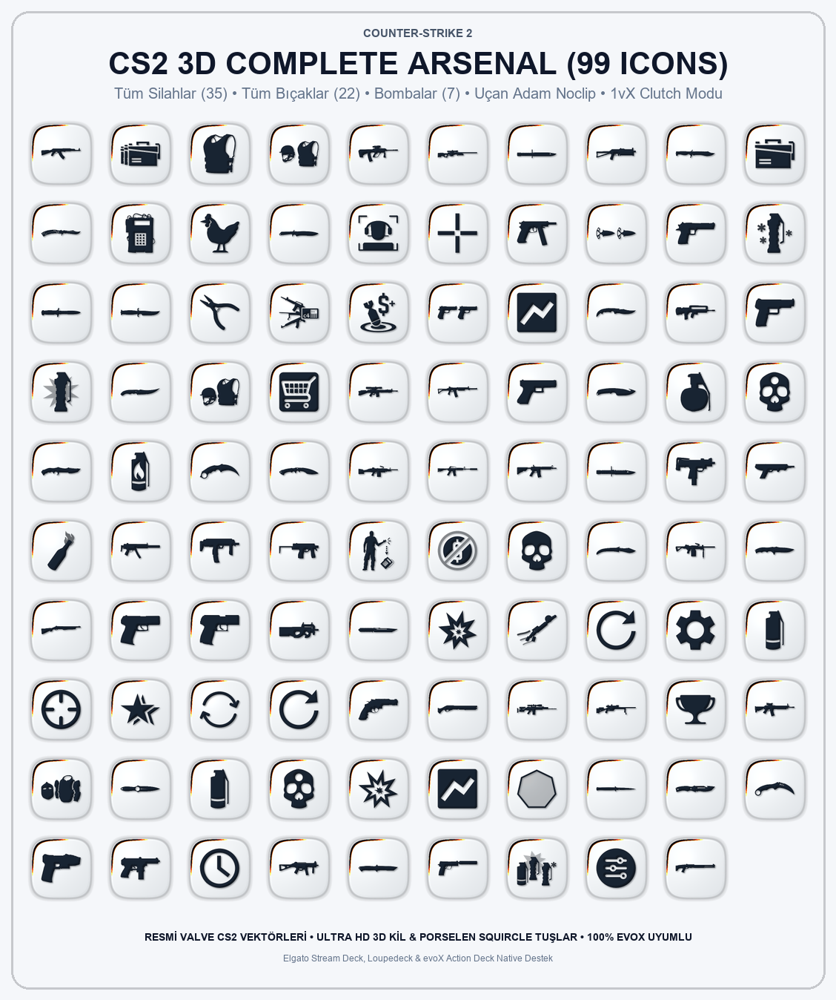

# 🎯 Counter-Strike 2 Tactical 3D Suite (99 Master Icons)

[-38bdf8.svg?style=for-the-badge)](https://github.com/Hfatih/cs2-tactical-icons)

> **Valve Counter-Strike 2 resmi oyun vektörleri** üzerinden modellenmiş, gerçek 3D hacimli porselen ve mat kil dokusuna sahip 99 parçalık eksiksiz taktiksel ikon paketi ve 15 tuşlu interaktif Stream Deck donanım simülatörü.

---

## 🕹️ Canlı Simülatör & Demo
15 tuşlu fiziksel Stream Deck simülatörünü doğrudan tarayıcınızda canlı olarak test edebilirsiniz:  
👉 **[Canlı Stream Deck Simülatörünü Aç](https://hfatih.github.io/cs2-tactical-icons/)**

- **5x3 (15 Tuş) Donanım Çerçevesi:** Gerçekçi LCD cam tuşlar ve fiziksel basma mekaniği.
- **Web Audio Dokunsal Ses:** Tuşlara her tıklandığında ultra düşük gecikmeli mekanik mikro-anahtar geri bildirimi.
- **5 Hazır Profil:** Canlı Maç Kontrolü, Taktiksel Silahlar, Bıçaklar Koleksiyonu, Bomba & Teçhizat, Telemetri.
- **İkon Atama:** 99'luk kütüphaneden dilediğiniz ikona tıklayarak seçili Stream Deck yuvasına tek tıkla atayın.

---

## 🎨 3 Farklı Kaplama (Finishes)

Her bir ikon 3 ayrı malzeme ve görsel dilde yüksek çözünürlükte sunulmaktadır:

| Kaplama | Dizin | Görsel Karakteristik |
| :--- | :--- | :--- |
| **⚪ Porselen Squircler** | `porcelain/` | Yumuşak açık krem seramik squircle zemin üzerinde 3D kabartmalı derin lacivert/karbon glifler ve ışık parıltısı. |
| **🤍 3D Kil Kesimler** | `glyphs/` | Şeffaf arka plan üzerinde havada süzülen 3D mat beyaz porselen/kil modeller (ambient occlusion ve gölge). |
| **⬛ Karbon Tuşlar** | `icons/` | Koyu karbon/gunmetal squircle tuşlar üzerinde 3D mat beyaz kil modeller ve metalik kenar ışığı. |

---

## 📦 Cephanelik Envanteri (99 Master İkon)

### 1. 🔫 Tüm Silahlar (35 Adet)
* **Piyade Tüfekleri (7):** AK-47, M4A4, M4A1-S, Galil AR, FAMAS, SG 553, AUG
* **Keskin Nişancı Tüfekleri (4):** AWP, SSG 08 (Scout), G3SG1, SCAR-20
* **Tabancalar (10):** Glock-18, USP-S, P2000, Çift Beretta (Dual Berettas), P250, Five-SeveN, Tec-9, CZ75-Auto, Desert Eagle, R8 Revolver
* **Hafif Makineli / SMG (7):** MAC-10, MP9, MP7, MP5-SD, UMP-45, P90, PP-Bizon
* **Pompalılar (4):** Nova, XM1014, Sawed-Off, MAG-7
* **Ağır Makineli (2):** M249, Negev
* **Özel (1):** Zeus x27 (Şok Cihazı)

### 2. 🔪 Tüm CS2 Bıçakları (22 Adet)
Karambit, Kelebek Bıçak (Butterfly), M9 Bayonet, Süngü (Bayonet), İskelet Bıçak (Skeleton), Kukri Bıçak (Kilowatt Case), Huntsman, Sustalı Bıçak (Stiletto), Talon Bıçak, Gölge Hançerler (Shadow Daggers), Katlanır Bıçak (Flip Knife), Kanca Bıçak (Gut Knife), Falchion Bıçak, Bowie Bıçak, Ursus Bıçak, Navaja Bıçak, Paracord Bıçak, Hayatta Kalma Bıçağı (Survival), Göçebe Bıçak (Nomad), Klasik Bıçak (CS 1.6), Varsayılan CT Bıçağı, Varsayılan T Bıçağı.

### 3. 💣 Bombalar & Taktik Ekipman (7 Adet)
Flaş Bombası (Flashbang), Sis Bombası (Smoke), El Bombası (HE), Molotof (T), Yangın Bombası (CT Incendiary), Yem Bombası (Decoy), Tam Bomba Paketi (Utility Set).

### 4. 🛡️ Teçhizat & Görev Öğeleri (8 Adet)
C4 Patlayıcı Çantası, Kurulmuş C4 Bombası, İmha Kiti (Defuse Kit), Kevlar Yelek, Yelek + Kask, Taktik Ağır Kalkan, Ağır Mühimmat Kutusu, CS2 Maskot Tavuk (Pet).

### 5. ⚡ Canlı Maç Kontrolleri & Telemetri (27 Adet)
* **🚀 Uçan Adam (Noclip):** Havada süpersonik rüzgar akımlarıyla süzülen 3D taktik operatör heykeli.
* **👑 1vX Clutch Modu:** Odaklanmış nişangah vizörü, taktik kulaklık, mikrofon susturma çizgisi ve 1vX CLUTCH rozeti.
* **Kombine Satın Almalar:** Full Buy Kombosu, Force Buy Kombosu.
* **Maç İçi Telemetri:** Takım Ekonomisi, Rakip Kayıp Bonusu, Headshot Oranı, Multi Kill, Oturum Özeti, Kişisel Rekor, Mola/Timeout, Bomba Geri Sayım Süresi, İzleyici Ekonomisi.
* **Antrenman & Binds:** Antrenman Modu, Sis Çizgileri (Lineups), Bomba Tekrarı (Rethrow), Demo Kaydı, Bind Yenile, Radar Yakınlaştırma, Crosshair Seçici, Viewmodel Seçici.

---

## 🚀 Kurulum & Kullanım

### 1. Elgato Stream Deck & Loupedeck
1. İstediğiniz kaplama klasöründeki (`porcelain/`, `glyphs/` veya `icons/`) PNG dosyalarını açın.
2. Stream Deck yazılımında istediğiniz tuşa sürükleyip bırakın.
3. Tuşa basma eylemini veya kısayol tuşunu atayın.

### 2. evoX Action Deck
1. `CS2 Tactical Icons.evoxpack` dosyasını indirin.
2. evoX yazılımına çift tıklayarak veya içe aktar diyerek yükleyin.
3. Tüm 29 CS2 Kontrol aksiyonu ve 99 ikon kütüphanenize otomatik eklenir.

---

## 🛠️ Teknik Detaylar
- **Kaynak Geometri:** Valve CS2 Resmi Panorama SVG Veri Havuzu
- **Render Pipeline:** Volumetric Distance Field Dome Transform + 5x5 Sobel Normal Mapping + Ambient Occlusion + Directional Key Light (`-0.577, -0.577, 0.577`) + Drop Shadow
- **Format:** Yüksek sıkıştırmalı 32-bit RGBA PNG (288x288 Supersampled to 144x144, 512x512 Master)
- **Doğrulama:** 100% Zod Validator ve Stream Deck spesifikasyonlarına tam uyumlu.

---

## 📄 Lisans
Bu proje [MIT Lisansı](LICENSE) altında dağıtılmaktadır. CS2 ve silah logoları Valve Corporation'ın tescilli markalarıdır.
